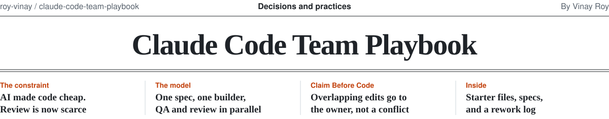
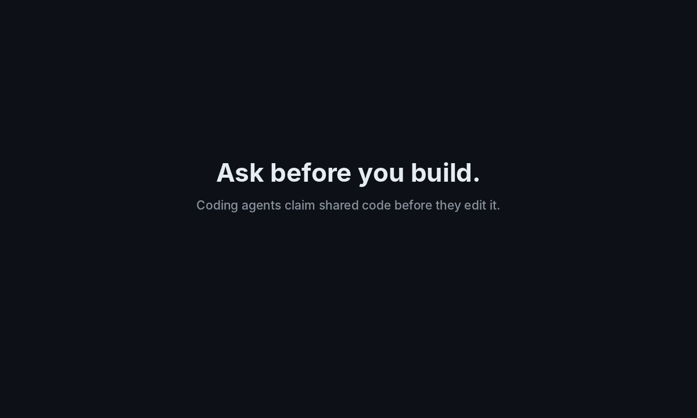
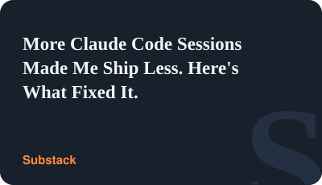

<picture>
  <source media="(prefers-color-scheme: dark)" srcset=".github/assets/masthead-dark.svg">
  
</picture>

<p>&nbsp;</p>

**AI made code cheap. Review is now the scarce resource.**
This playbook organizes coding agents around that one constraint.

Companion to the article [More Claude Code Sessions Made Me Ship Less. Here's What Fixed It.](https://vinayroy.substack.com/p/more-claude-code-sessions-made-me) by Vinay Roy.

---

## Why this exists

Running more coding agents did not make me ship more.

It gave me more unfinished work, longer review queues, and more rework.
The agents were fast. I was the bottleneck.
I could only read so many diffs a day, and I started skimming them.

This repo is the workflow I ended up with. It is small on purpose.

## The operating model

```
               ONE-PAGE SPEC
                     │
                     ▼
                  BUILDER
             own worktree
                     │
                     ▼
                   DIFF
                     │
            ┌────────┴────────┐
            ▼                 ▼
           QA             REVIEWER
        behavior            code
    "Does it work?"    "Is it sound?"
     cannot edit        read only
            │                 │
            └────────┬────────┘
                     ▼
               HUMAN REVIEW
                     │
              ┌──────┴──────┐
              ▼             ▼
            MERGE         REWORK
                            │
                            └──→ log it

  ╔═══════════════════════════════════════╗
  ║  Review units ≤ what you can truly    ║
  ║  read today                           ║
  ╚═══════════════════════════════════════╝
```

Four rules, and nothing else:

1. **One spec.** Nothing starts without a one-page spec.
2. **Three roles.** Builder, QA, Reviewer. Each does one job.
3. **One limit.** Cap review units, not agents. A review unit is one coherent change you can understand, check, and own as a whole.
4. **One metric.** Measure shipped work and rework, not code generated.

## Why the roles are separate

**What's the difference between QA and Reviewer?**
QA checks behavior: does it work, and can I break it?
The reviewer checks the code: is it correct, safe, and easy to maintain?
A change needs both before it reaches you.

**Why can't QA edit code?**
If QA can fix what it tests, it becomes a second builder.
Its goal quietly shifts from "find what's broken" to "make my version pass."
A QA role that can only run and report stays honest.

**Why does the reviewer start fresh?**
A session that wrote the code, or watched it being written, shares its blind spots.
A reviewer with no context has nothing to defend.
It reads the diff the way a new teammate would.

**Why must the builder list what it skipped?**
"Done!" is not a report.
A list of what was not done, and what could go wrong, tells you where to look first.

## The constraint

Your review capacity sets your team size. Not your token budget.

For me, that has usually meant two or three builders on a focused day,
and one on a meeting-heavy day.
QA and research sessions don't count. Only sessions that make code you must review.

Beyond that point, I found that more builders stopped raising what I shipped.
They mostly raised the number of diffs waiting for a proper read.

**This is not a cap on agents.** It's a cap on separate changes that reach you.
Many builders can work at once if each owns its own files, the order is set up front,
and the combined result is reviewed as one change.
See [docs/parallel-builders.md](docs/parallel-builders.md) for ten tactics, and [Claude Code: Subagents vs Agent Teams](https://vinayroy.substack.com/p/claude-code-subagents-vs-agent-teams-54cacb96f6c0) for how to split the work.

## Does it work?

This section will hold real observations, not lab results.
I'm tracking the same workflow before and after the change, using `rework-log.md`.

| Week | Builders/day | Changes shipped | Sent back | Review hours | Rework rate |
|------|--------------|-----------------|-----------|--------------|-------------|
| W1   |              |                 |           |              |             |

Numbers will be added week by week, good or bad. They are operational notes from one person's work, not a controlled study.

## When builders belong to different people

`check-owner.sh` works when one person splits the work. It doesn't help when each developer
runs their own agents on their own tickets, and those agents reach into the same shared code.



For that, see [Claim Before Code](claim-before-code/README.md): before an agent edits anything, it claims the folders,
files, or hot-file functions it will change. Overlaps and code owned by someone else go to that
owner as a request, not to a merge conflict. A hook blocks unclaimed edits, and a pull request
check catches the rest. Companion to [When Your Team's Coding Agents Start Stepping on Each Other](https://vinayroy.substack.com/p/when-your-teams-coding-agents-start).

## What about Claude Code agent teams?

This playbook is an operating model, not an orchestration tool.
It works whether you run separate sessions by hand or use Claude Code's agent teams.

The tool decides how agents run.
This playbook decides how many should run, and who checks their work.

The constraint stays the same either way:
**don't generate work faster than you can verify it.**

## Small on purpose

Other Claude Code playbooks add more agents, skills, and workflows.
This one doesn't, by design.

More builders create more output to review.
More roles and workflows create more coordination.
This playbook adds neither unless it earns its place.

---

## What's inside

| File | What it does |
|------|--------------|
| `.claude/agents/builder.md` | Builds from a spec, in its own worktree |
| `.claude/agents/qa.md` | Tries to break the feature. Can't edit code |
| `.claude/agents/reviewer.md` | Reads the diff with fresh eyes. Read only |
| `CLAUDE.md` | Team rules every session follows |
| `.claude/settings.json` | Permissions, a test hook, and a nesting limit |
| `specs/TEMPLATE.md` | The one-page spec every feature starts from |
| `rework-log.md` | Weekly tracking of shipped work and rework |
| `docs/parallel-builders.md` | Ten tactics for many builders without conflicts |
| `docs/setup-notes.md` | Limits, messaging, cost, and when to stick with one session |
| `scripts/check-owner.sh` | Hook that blocks edits outside a builder's folder |
| `claim-before-code/` | Claim Before Code: agents claim code before editing, overlaps go to the owner |

## How to use it

1. Copy `.claude/`, `CLAUDE.md`, and `specs/` into your project.
2. Edit `CLAUDE.md` and the hook command to match your stack.
3. Start with two sessions: `claude --agent builder` and `claude --agent qa`.
4. Add the reviewer once those two feel easy.
5. Fill in `rework-log.md` every week. Add a builder only when rework goes down.

## Notes

- Commands and settings follow the [Claude Code docs](https://code.claude.com/docs) at the time of writing. Check there if something doesn't work.
- The hook assumes `npm`. Swap in your own lint and test commands.

<a href="https://vinayroy.substack.com/p/more-claude-code-sessions-made-me"><picture><source media="(prefers-color-scheme: dark)" srcset=".github/assets/tile-article-dark.svg"></picture></a>

The article this playbook comes from.

## About

<a href="https://www.linkedin.com/in/royvinay"><picture><source media="(prefers-color-scheme: dark)" srcset="https://raw.githubusercontent.com/roy-vinay/roy-vinay/main/cards/about-dark.svg"></picture></a>

VP of Product at [Burq.ai](https://burq.ai), leading Product and AI.

Before Burq, I was the founding product leader at an AI SaaS startup, taking it from zero to product-market fit and building multi-agent systems in production. Before that, I led a global team of about 80 across Product, Data Science and Analytics at Vista, the private aviation group behind VistaJet and XO. Earlier: marketplace growth at Zeus Living, macOS and iOS features at Apple (including Sidecar), and engineering teams at Qualcomm and NVIDIA.

For seven years I was Head Instructor for the AI/ML executive program at UC Berkeley Executive Education, teaching more than 10,000 business leaders. 3 US patents, MBA from Berkeley Haas, MS from IIT Roorkee. San Jose, CA.

<picture>
  <source media="(prefers-color-scheme: dark)" srcset="https://raw.githubusercontent.com/roy-vinay/roy-vinay/main/dark_mode.svg">
  
</picture>

## License

MIT. See [LICENSE](LICENSE).

---


<sub><strong>Independently developed.</strong> Not affiliated with or endorsed by my employer.</sub><br>
<sub><strong>Confidentiality:</strong> No proprietary code, data, or confidential information is included.</sub>
